# Dawn

A bedside DAB+ alarm clock radio for Raspberry Pi: a 4.3" touch face, DAB+ via an
RTL-SDR, AirPlay 2 and Bluetooth, GPS/DAB/NTP-disciplined time, ambient-light
brightness, and a mobile control UI at `http://dawn.local:8080/`.

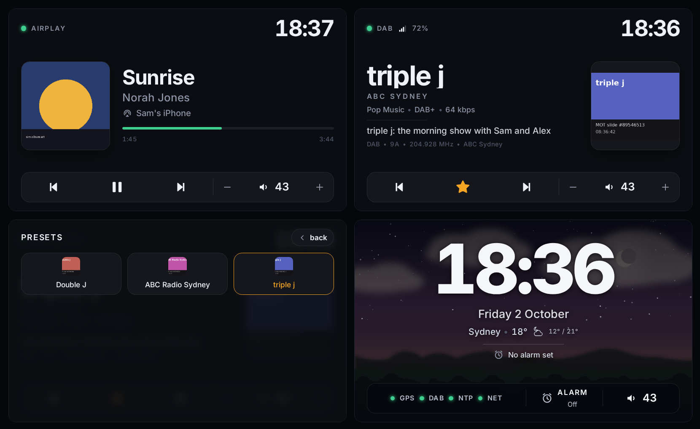

| Face states | Control UI |
|---|---|
|  | 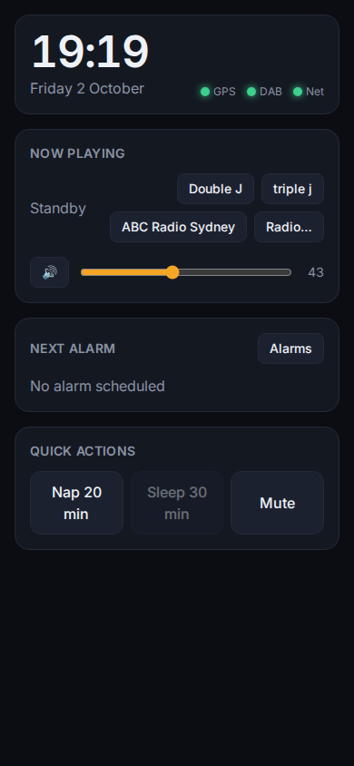 |
|  | 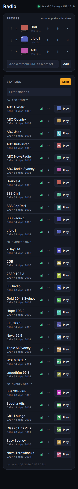 |
| 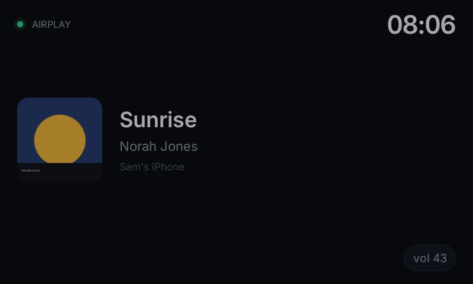 | 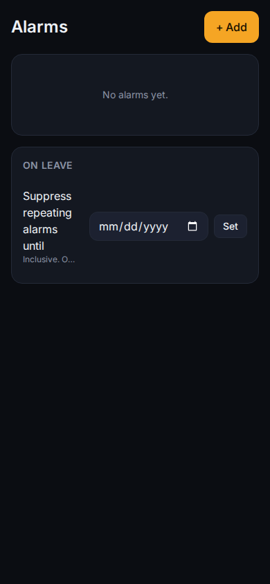 |
| 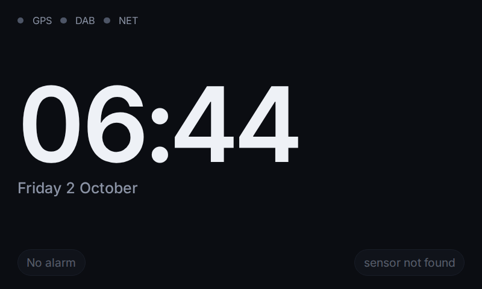 | 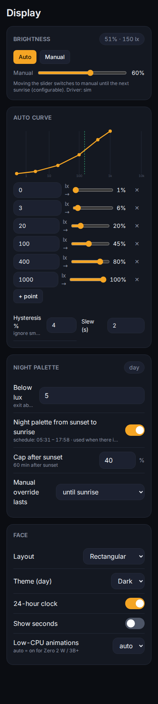 |
| 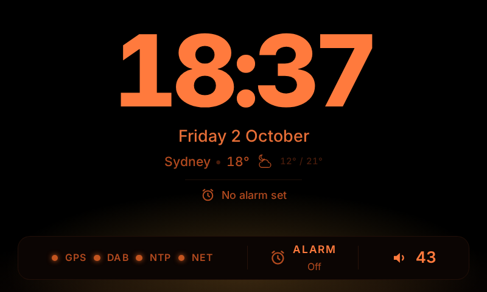 | 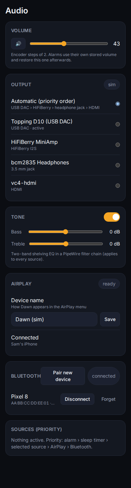 |
|  | 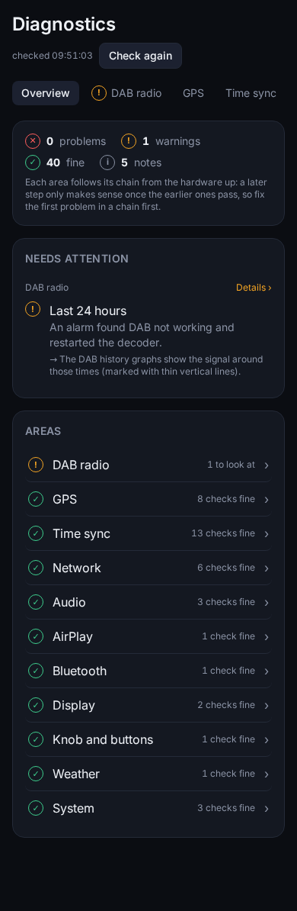 |

| Diagnostics: DAB radio | Diagnostics: time sync |
|---|---|
| 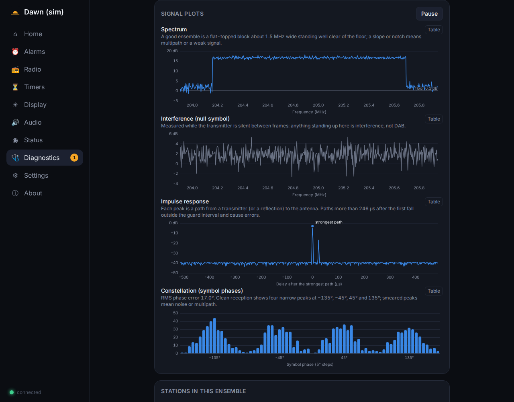 | 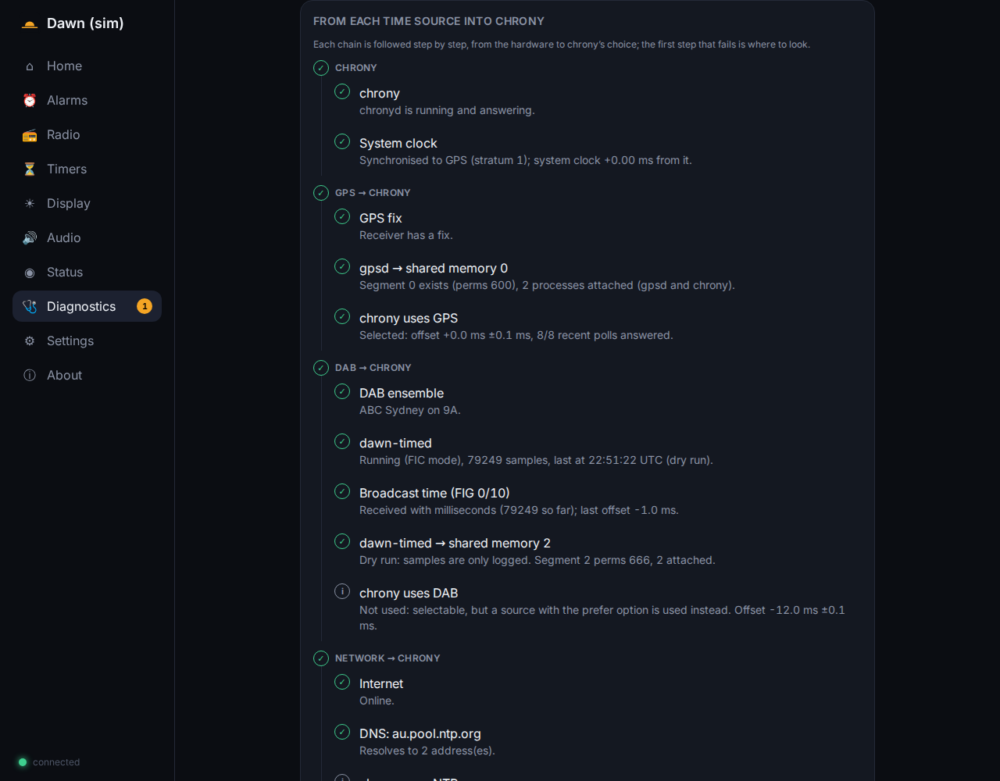 |

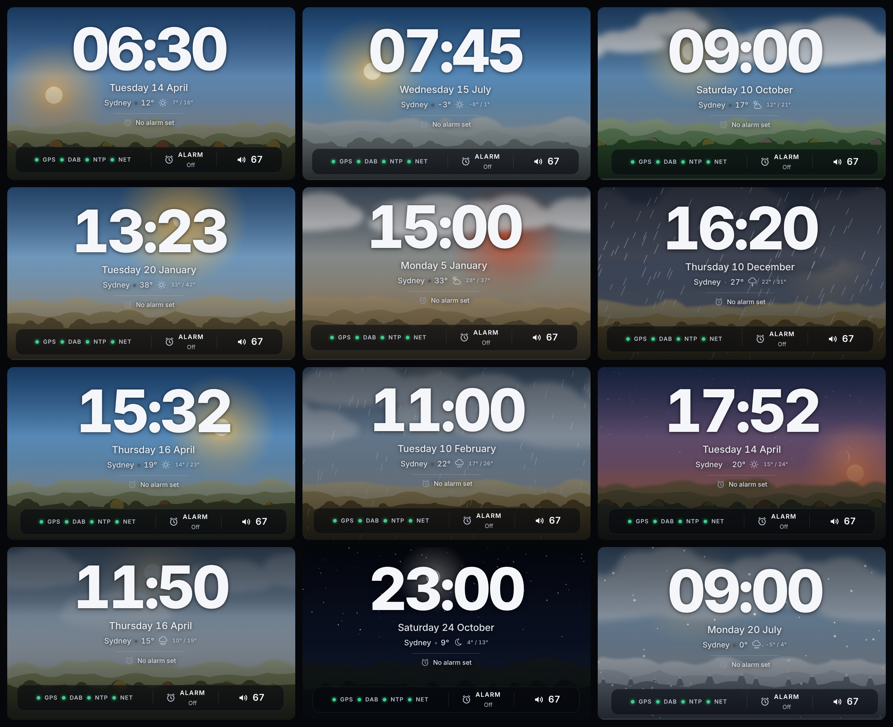

More renders in [`docs/screenshots/`](docs/screenshots/). The face is one small design
system: the clock always sits top-right, a status line top-left says which mode is active
and whether audio is flowing, the middle is a 40/60 artwork/identity split, and a
persistent control bar runs along the bottom. Left alone while playing, the face becomes
an ambient clock with a now-playing strip (`display.ambient_after_s`); a tap brings the
player back. Standby sits on a soft procedural scene (sky, sun, moon in its phase, stars, clouds,
drizzle, rain, storms with lightning, hail or snow, fog, frost, heat haze and smoke, hills and
trees) drawn from the time relative to sunrise and sunset, the *forecast for the hour coming
up* (Open-Meteo's hourly weather, cloud, rain, wind and visibility) and the season, with
Australian seasons south of the equator (straw-gold summers, green winters, wattle in spring);
the clouds drift with the wind and the rain or snow falls at its slant, so it is never still; it switches off in the night palette and can be disabled
with `display.scene`. At night the face goes into [sleep mode](#sleep-mode-and-burn-in): the
clock alone, small and amber on black, moving every couple of minutes. Anything that can go
wrong (DAB reception, GPS, each time source into chrony, network, audio, the Pi itself) is
checked and explained on the control UI's [Diagnostics](#troubleshooting) page, with live
readings, a week of history and one-tap fixes.

## Contents

- [Hardware](#hardware) · [Wiring](#wiring)
- [First boot](#first-boot) · [Updating](#updating)
- [Controls](#controls) · [Alarms that always ring](#alarms-that-always-ring) · [Keeping itself running](#keeping-itself-running) · [Cool mode](#cool-mode)
- [Laptop simulator](#laptop-simulator)
- [Architecture](#architecture) · [Configuration](#configuration)
- [Troubleshooting](#troubleshooting)
- [Development](#development) · [Acceptance checklist](docs/ACCEPTANCE.md)

## Hardware

Reference build. The whole clock runs from one 5 V USB-C supply; every part is
auto-detected at boot and the fallbacks stay supported:

| Part | Reference build | Fallbacks |
|---|---|---|
| Board | Raspberry Pi 4 B, Raspberry Pi OS Lite 64-bit (Oct 2026); passive heatsink, no fan | Pi 5 (22-pin DSI cable, 27 W PSU), Pi 3B+, Pi Zero 2 W (HyperPixel/HDMI only, low-CPU face) |
| Power | 5 V 3 A USB-C (KSA-15E-052300HA); ~7–8 W typical, ~13 W worst case | — |
| DAB+ | RTL-SDR Blog V4 (librtlsdr from the rtl-sdr-blog fork, pinned release), on a short USB extension, outside the case | any RTL2832U/R820T2 stick (named from its USB strings) |
| GPS (optional) | u-blox 7 USB (VK-172 / VK-162), `/dev/ttyACM0`, NMEA 9600, no PPS; picked up whenever it is plugged in | none: DAB and NTP time, the location from *Settings*; shown as "not fitted" (a hollow yellow ring), never as a fault |
| Display | Waveshare 4.3" DSI 43H-800480-IPS-CT, 800×480, Goodix touch over the ribbon, sysfs backlight 0–255 (`dtoverlay=vc4-kms-dsi-7inch`) | Pimoroni HyperPixel 4.0 Touch (DPI, PWM backlight); any HDMI panel (software dimmer) |
| Light sensor | PiicoDev VEML6030, I2C bus 1, 0x10, behind a window facing the room | VEML7700, BH1750; none (sunrise/sunset schedule) |
| Audio | Pimoroni Audio Amp SHIM (MAX98357A, I2S, mono ~2.5 W into 4 Ω; the installer default) → Dayton PC68-4 2.5" 4 Ω full-range in a ~0.5 L sealed box | USB DAC; HiFiBerry DAC/MiniAmp; 3.5 mm jack; HDMI |
| Inputs | touch (everything is on the screen) + Adafruit 377 bare rotary encoder with push switch (internal pull-ups) | optional big arcade button (off by default; GPIO, `gpiozero` + `lgpio`) |
| Backup buzzer | none: the backup tone plays through the speaker and the face | optional active 3.3 V piezo buzzer on a free GPIO (`alarm_defaults.buzzer.gpio_pin`), sounding even when the speaker path cannot |

### Recommended additions

1. **The optional GPIO piezo buzzer** (`alarm_defaults.buzzer.gpio_pin: 26`). The speaker path (I²S → SHIM → driver)
   is a single point of failure, and the face's backup beeps go through the same amp: the piezo is the only alarm
   sound that does not depend on it.
2. **A DS3231 RTC module** on I²C bus 1 (address 0x68; the light sensor at 0x10 does not clash), or a battery for the
   Pi 5's RTC: the right time from the first second after a power cut, with or without GPS or a network. The installer
   finds it and sets it up.
3. **The RTL-SDR V4 outside the case**, on its short extension, in a USB 2 (black) port, away from the SHIM's speaker
   leads: it runs warm and adds heat right next to the SoC.
4. **Ventilation**: slots low and high for a chimney draught, and a heatsink case or a thermal pad to a metal back
   panel. A fan is not recommended by a bed; if one is fitted, use a 5 V fan switched by a transistor on a free GPIO
   with `dtoverlay=gpio-fan,gpiopin=<pin>,temp=70000`, so it only runs when hot.
5. **The specified 5.1 V / 3 A supply, directly**: under-voltage is what drops the SDR off the bus and corrupts SD
   cards. Use a high-endurance SD card, or the `--data-device` option.
6. **Optional**: a UPS HAT, if alarms must ring through power cuts.

The SHIM has no hardware volume and one channel, so Dawn does it in software: the
PipeWire filter chain mixes left and right to mono, high-passes at 110 Hz
(`audio.eq.highpass_hz`) and allows bass cuts but no boost (`audio.eq.bass_max_db`);
`audio.output_ceiling_percent` sets where volume 100 lands, so calibrate it on the device
to sit just below audible clipping (see [Calibrating the volume ceiling](#calibrating-the-volume-ceiling)).
Sink priority at boot is USB › I2S amp › headphone jack › HDMI; the installer
pins the I2S amp (`audio.pinned_sink: hifiberry`) so a USB audio device plugged in later
cannot take over. Pin something else in *Audio* (web UI) or in the config.

## Wiring

BCM numbering. Input pins are configurable in `/etc/dawn/config.yaml` (`inputs:`). No
pins clash: the SHIM sits at the base of the 40-pin header and the other wires push onto
the pins above it.

| Header pin | BCM | Use | Part / wire |
|---|---|---|---|
| 1 | 3V3 | sensor power | VEML6030, red |
| 2, 4 | 5V | amp power | SHIM |
| 3 | GPIO2 (SDA) | I2C bus 1 | VEML6030, blue |
| 5 | GPIO3 (SCL) | I2C bus 1 | VEML6030, yellow |
| 9 | GND | sensor ground | VEML6030, black |
| 11 | GPIO17 | encoder A (CLK) | ADA377 outer pin |
| 13 | GPIO27 | encoder B (DT) | ADA377 other outer pin |
| 14 | GND | encoder common | ADA377 middle pin |
| 15 | GPIO22 | encoder switch | ADA377 switch pin |
| 20 | GND | encoder switch return | ADA377 other switch pin |
| 12 | GPIO18 | I2S bit clock | SHIM |
| 35 | GPIO19 | I2S LR clock | SHIM |
| 40 | GPIO21 | I2S data | SHIM |
| 22 | GPIO25 | driven high at boot (`gpio=25=op,dh`) | SHIM |
| 16 | GPIO23 | unused (big button not fitted) | — |
| 37, 39 | GPIO26, GND | optional backup buzzer (`alarm_defaults.buzzer.gpio_pin: 26`) | active piezo + to 37, − to 39 |
| — | DSI ribbon (~50 mm) | display power, video and touch I2C; no GPIO | Waveshare 43H |
| — | USB | RTL-SDR (short extension), GPS | |

The bare encoder has no pull-ups and no + pin: the A, B and switch pins are pulled up
inside the Pi and the contacts switch them to GND. It gives one volume step per detent
(24 per turn). If it turns the wrong way, swap the GPIO17 and GPIO27 wires or set
`inputs.encoder.invert: true`. Speaker leads are short, twisted and routed away from the
SDR antenna lead: the SHIM's output is unfiltered ~300 kHz PWM.

> HyperPixel 4 uses GPIO 0–25 for DPI, which also collides with the SHIM's I2S pins. With
> that panel use a USB DAC, and remap the encoder and button to free pins in `inputs:` —
> the installer prints a reminder.

> HyperPixel 4 uses GPIO 0–25 for DPI. With that panel, remap the encoder and
> button to the free pins (GPIO 26/27 or via the HyperPixel's breakout) in
> `inputs:` — the installer prints a reminder.

## First boot

1. Flash Raspberry Pi OS Lite (64-bit) and enable SSH and Wi-Fi in the imager.
2. On the Pi:
   ```bash
   sudo apt-get install -y git
   sudo git clone https://github.com/tunlezah/dawn /opt/dawn
   sudo /opt/dawn/deploy/install.sh   # Audio Amp SHIM; --audio usb|headphones|hdmi|auto for other outputs
   sudo reboot
   ```
   The installer detects the board and display, writes the `config.txt`
   overlays, builds `rtl-sdr-blog`, `welle.io`, `shairport-sync` + `nqptp`,
   installs gpsd/chrony/PipeWire/BlueZ/cage/Chromium, creates the `dawn` user
   and enables the `dawn-core`, `dawn-dab`, `dawn-timed` and `dawn-face` units.
   It is idempotent; re-run it any time; a run without `--audio` keeps the output chosen by an
   earlier install (`/etc/dawn/audio-output`). Options: `--display`, `--audio`, `--data-device`, `--data-image-mb`,
   `--readonly`, `--no-build`, `--rebuild`.

   With the SHIM (default, `--audio shim`) the `config.txt` block gets `dtparam=audio=off`,
   `dtoverlay=hifiberry-dac` and `gpio=25=op,dh`; the mono filter chain
   (`deploy/pipewire/dawn-eq-mono.conf`) is installed and `audio.pinned_sink` set to `hifiberry`; WirePlumber keeps the sink running
   while idle so the MAX98357A does not pop. The DSI panel gets `dtoverlay=vc4-kms-dsi-7inch`.
   If the case mounts the panel rotated, set `display.rotation` (90/180/270) in
   `/etc/dawn/config.yaml` and re-run the installer: it adds
   `video=DSI-1:800x480M@60,rotate=…` to `cmdline.txt` and a matching libinput touch
   calibration matrix (`/etc/udev/rules.d/98-dawn-touch.rules`), then reboot.
3. The face reaches standby within about 40 s. Without a network it starts a
   setup hotspot and shows its SSID, password and a Wi-Fi QR code; join it and
   open `http://10.42.0.1:8080/` to pick a Wi-Fi network. (Once a Wi-Fi network is saved, losing it later does not
   take over the face; see *Wi-Fi lost* under [Troubleshooting](#troubleshooting).)
4. Open `http://dawn.local:8080/` (core listens on port 8080; nothing answers on 80):
   - **Radio → Scan** to find DAB+ ensembles (Australian capital channels first),
     star stations as presets.
   - **Alarms → Add**.
   - **Settings** for location (or let the GPS fill it), holiday state, time
     zone, name, PIN, backups and updates. *All options* edits any config value.

### Calibrating the volume ceiling

The amp's gain is fixed, so where clipping starts depends on the build. With the case
closed: set `audio.output_ceiling_percent: 100`, play loud, bass-heavy music at volume
100, and lower the ceiling in steps of 5 (*Settings → All options → audio*) until the
distortion goes away; then confirm an alarm
at volume 100 is clearly loud enough at 1 m. Every path — the controls, alarm ramps,
chimes, the sleep fade — scales into that ceiling; `audio.max_volume` additionally caps
the 0–100 scale itself.

## Updating

- From the UI: *Settings → Software update → Check for updates*, then *Update now*. It runs `dawn-update.service`
  (its own unit, so restarting dawn-core cannot cut it short): fast-forwards `/opt/dawn` to GitHub `main`, runs
  `install.sh --update --no-restart` (the web UI is built beside the one in use and swapped in only when complete),
  restarts dawn-timed and the decoder, then dawn-core, waits for it to report the new version healthy, and restarts
  the face last. If dawn-core does not come up healthy within two minutes, or any step fails, it rolls back to the
  previous commit, web UI and Python packages and says so (*Settings*, *Diagnostics → System*, a toast on the face).
  It will not start during an alarm, a snooze or a nap, or within `system.update_quiet_minutes` (60) of the next
  alarm. Log in `/var/log/dawn-update.log`. The version shown there goes up with every merged PR.
- From a laptop: `make deploy HOST=dawn.local` builds the web UI and rsyncs the repo. The files then differ from
  `/opt/dawn`'s git commit, so the UI update refuses to fast-forward until they match `main` again.
- On the Pi: `cd /opt/dawn && sudo -u dawn git pull --ff-only && sudo ./deploy/install.sh --update`.

The UI update needs `/opt/dawn` to be a git checkout of `main`. An install made from a copied folder whose
history is not GitHub's is told so by *Update now*, along with the one-time fix:
`sudo -u dawn git -C /opt/dawn reset --hard origin/main` (discards local commits and edits in `/opt/dawn`).

## Controls

Never ambiguous; snooze and stop are never on the same control. Touch does everything;
the encoder is fitted on the reference build, and the big button is optional (off unless
`inputs.big_button.enabled`); both keep their jobs when fitted.

| Control | Ringing | Playing | Standby |
|---|---|---|---|
| Tap the screen | **snooze** | menu sheet; from the ambient clock: back to the player | menu sheet |
| Hold the screen 2 s | **stop** | — | — |
| Menu sheet | — | Presets · Nap · Sleep · Brightness · **Standby**, and a volume slider (mute on the speaker) | same, with **Radio on** (first preset) in place of Standby |
| Standby tile, hold 3 s | — | safe shutdown with on-screen countdown (release to cancel) | same, on the Radio on tile |
| Control bar | — | ◀◀ ❚❚ ▶▶ for AirPlay/Bluetooth, ◀ ☆ ▶ (preset prev / star / next) for radio | — |
| Big button, short | **stop** | stop playback → standby | wake face to full for 20 s |
| Big button, hold 3 s | **stop** (never a shutdown while ringing) | safe shutdown with on-screen countdown (release to cancel) | same |
| Encoder rotate | volume (steps of 2, overlay 1.5 s) | volume | volume |
| Encoder push | **snooze** | next preset | first preset |
| Encoder hold | **snooze** | nap-timer picker | nap-timer picker |

The menu is a sheet that slides up over the bottom of the screen; the clock and what is
playing stay visible above it. It closes on a tap outside it or after
`inputs.touch_menu_timeout_s` (15 s) without a touch; a finger on the slider or a tile holds
it open. Volume only appears with the sheet rather than sitting in the control bar. The
Standby tile *is* the big button: a tap is its short press and a hold is the same shutdown
countdown, so a clock with the button fitted and one without behave the same.

### Alarms that always ring

An alarm has to make a noise whatever else is broken, so it climbs a ladder of sounds and each rung is
watched for audio actually reaching the speaker:

1. **Its own source** (a DAB station, a stream, a playlist, a chime), ramping up over `ramp_seconds`.
2. **The chime**, when nothing is heard `fallback_after_s` (15 s) after the alarm, or when the source stops for
   10 s mid-ring.
3. **The backup tone**, when the chime is not heard either within `alarm_defaults.buzzer_after_s` (8 s): beeps
   generated by core and played *without* mpv, by the first of `pw-play`, `paplay`, `aplay` on ALSA's default
   device and `aplay` straight on each sound card that works (the last only succeeds when PipeWire itself is
   what broke). The face beeps along through Chromium, and an optional GPIO buzzer
   (`alarm_defaults.buzzer.gpio_pin`) sounds with it, independent of the whole audio stack.

The ring shows on the face at once and the backlight comes up as for a tap (dimly at night). What else keeps it
ringing:

- **Prepared minutes ahead** (`alarm_defaults.prepare_minutes`, 5): the alarm's players are started, a DAB
  station is tuned and checked for sync on air, and a scan cannot start into the alarm (one already running is
  stopped). Someone listening to the radio on another channel is not cut off early: it retunes when the alarm
  rings. A source found not to work starts the alarm on the chime straight away instead of after 15 s of
  silence; the next-alarm card and *Diagnostics → Audio* say what was found.
- **The radio is the alarm's while it rings or is snoozed**: retunes, decoder restarts and gain changes from the
  web wait, and the alarm has mpv players of its own, so nothing that was playing can pause it.
- **Restarts don't drop it**: a ring or a snooze in progress is saved, and dawn-core carries on with it after a
  crash, a watchdog restart or an update; a nap timer too. A nap stays saved until its ring has started, and a ring
  that will not start is retried and then falls back to the backup tone.
- **Clock steps don't move it**: naps, snoozes and the sleep timer run on the monotonic clock, so chrony stepping the
  time at boot neither shortens nor stretches them (a `clock_step` event records each step). systemd's watchdog is fed only while the alarm engine
  ticks, and never gives up restarting dawn-core.
- **Storage failures don't stop it**: an SD card gone read-only or a full disk cannot keep an alarm from ringing
  (or make it ring twice), and one damaged alarm in the database cannot stop the others; *Diagnostics → System*
  reports failed writes.
- **The face rings by itself** if core does not answer at alarm time (no state and no `/api/health` for 20 s),
  or answers but cannot read its alarms (the database on the SD card is unreadable): 45 s after the alarm it beeps
  from what it last heard, a tap snoozes, a 2 s hold stops, all on the face. Its volume is the speaker's as core
  last set it, and with *Screen off* sleep the screen stays dark.
- **A broken card or config file does not stop it starting**: a database that cannot be written is read
  (alarms ring as saved, nothing new can be kept), one that cannot be read at all is replaced by an empty one so
  core still runs and the face rings from its own memory; a config file with a bad value keeps its good sections
  and the defaults for the rest. *Diagnostics → System* says which.

### Keeping itself running

systemd restarts whatever exits (`Restart=always`, and never gives up: `StartLimitIntervalSec=0`; chrony and gpsd get
the same through drop-ins), the hardware watchdog reboots a Pi whose kernel hangs, dawn-timed has a watchdog of its own,
and dawn-core's watchdog is fed only while its alarm engine, state pump, display loop and face and timer ticks run.
Every loop inside dawn-core is watched: one that dies is restarted in place (5 s, 30 s, 120 s apart), and if one the
alarms or the face depend on stays dead the watchdog is held back so systemd restarts dawn-core (`/api/health` lists
`loops_dead`; *Diagnostics → System → Background loops*). Memory pressure takes the kiosk first (`OOMScoreAdjust`). On
top of that dawn-core **checks the programs it depends on every 15 s and restarts what systemd cannot see is
broken** (`system.supervisor`):

| What | When it is restarted |
|---|---|
| The face kiosk (`dawn-face`: cage + Chromium) | no face has connected, the page has stopped sending its 15 s heartbeat, or it still pings but has drawn no frame for a minute, for `face_absent_s` (150 s) while the unit has been active that long: a blank, "can't reach" or frozen Chromium. Also once a day at the first quiet moment after `face_recycle_at` (03:30): Standby or the sleep clock, nothing playing, no alarm within the hour |
| chrony, gpsd when hung | chronyc has timed out on four polls in a row; gpsd is connected with a receiver fitted but has sent no position for two minutes |
| NetworkManager (optional, `wifi_driver_recovery`) | a saved Wi-Fi network and wlan0 missing or unavailable for 10 minutes; twice at most, then Diagnostics suggests a reboot |
| The DAB decoder (`dawn-dab`: welle-cli) | running but not answering HTTP for `welle_dead_s` (45 s) with the stick plugged in; or answering with no sync for `dab.no_sync_restart_s` (180 s) on a channel a scan found good (a stick that stopped delivering samples), with no scan running. Never while an alarm on the radio is ringing or snoozed (its own ladder handles that) |
| The RTL-SDR stick | three "no sync" decoder restarts in a row with the stick still on the bus: re-enumerated on USB (`dawn-usb-reset`); still nothing after 3 minutes and *Diagnostics → DAB radio* asks for a replug |
| The PipeWire session (`pipewire`, `wireplumber`, `pipewire-pulse`, user units) | `failed`, or wireplumber `inactive`; then the sink, volume and filter chain are set up again |
| `dawn-timed` | its status file is older than `timed_stale_s` (5 min) while the unit says active |
| Any unit left `failed` (`shairport-sync`, `nqptp`, `gpsd`, `chrony`, `bluetooth`, `avahi-daemon`, `NetworkManager`, Dawn's own) and Dawn's own units seen `inactive` for 30 s | only units that are enabled on this box; a failed unit means systemd gave up on it |
| The setup hotspot (`network.hotspot`) | on a box with a saved Wi-Fi network: taken down every 3 minutes to look for that network, and the network joined when it is in view; never while a phone is connected to the hotspot |
| A part of dawn-core that could not start at boot (PipeWire tools not answering yet, bluetoothd late, a busy GPIO chip) | its `start()` is tried again after 1, 2, 4… minutes (15 at most) until it works |

Every restart waits until the problem has been seen for a while, is held back by a backoff that doubles while the
same thing keeps breaking (`min_backoff_s` 60 s to `max_backoff_s` 30 min; it starts over after ten good
minutes), is logged as a `supervisor_repair` event in the journal, and is listed under *Diagnostics → System →
Self-repair* with what, when and why. The privileged restarts are exactly the lines in `deploy/sudoers/dawn`.
`system.supervisor.enabled: false` turns it all off; *Status → Hardware → Services* still shows every unit's state.

### Cool mode

On hot days, while nothing much is happening, the Pi runs cooler (*Display → Cool mode*, `power`): after five minutes
without anyone using the clock (no touch, controls, playback, ringing, timers or open control UI), and in *Auto* when
it is summer, a hot day is forecast or the SoC runs hot, it stops the DAB decoder, caps the CPU, freezes the face's
moving background and polls less. The alarms are never affected: the radio is running again minutes before any alarm
on DAB (and whenever you play a station, scan or open the DAB diagnostics), the CPU cap comes off when an alarm's
preparation starts, and any use of the clock ends cool mode at once. Diagnostics shows a paused decoder as *off*, not
as a fault. *On* cools whenever idle; *Off* never. Measure it on the device before tuning the defaults (see the
work-package notes): log `sys.temp` for 45 minutes with cool mode off and then on, at the same room temperature.

### Sleep mode and burn-in

In Standby at night the face shows the clock alone: small, deep amber on black at the lowest
backlight, with the next alarm and a weather icon under it, fading to a new place every two
minutes. Set it under *Display → Sleep mode* (`display.sleep`):

- **Goes to sleep** at the bedtime (22:30) *or* when the room goes dark (below 3 lx for a
  minute) — each on its own switch.
- **Wakes** at the morning time (06:30), 10 minutes before the next alarm (or its light wake),
  or when the room gets bright — whichever comes first. An alarm ringing always wakes it.
- Playing audio stays on screen until it stops; then the sleep clock takes over.
- A tap shows the full face, dimmed to 15 %, for `inputs.standby_wake_s`; a second tap opens
  the menu. With *Screen off* the backlight is off on a black screen and the first tap shows
  the sleep clock for 10 s.
- *Sleep now* / *Wake now* hold until the next bedtime, morning, alarm or change of light.

The panel is an IPS LCD, so the risk is image retention from things that never move. Besides
the moving sleep clock: the face's text drifts a few pixels over time (pixel orbit), the
Standby status strip fades after two minutes without a touch, the background never stands
still (clouds drift, the sun and moon cross the sky, the hills shift a few pixels over the day),
and its hills and trees are redrawn from the date each day (*Display → Burn-in protection*, `display.burn_in`).

## Laptop simulator

```bash
make setup     # .venv + editable installs + npm install
make sim       # simulators + core + dawn-timed; web UI on http://localhost:8080
```

- Face: http://localhost:8080/face · Control UI: http://localhost:8080/
- Sim hub (lux slider, GPS/DAB/SDR/network/saved Wi-Fi/phone-on-hotspot toggles, phone buttons for AirPlay and
  Bluetooth, encoder/button/touch, and faults for *Diagnostics*: DAB SNR, GPS signal,
  GPS unplugged, Wi-Fi level, failed services, an SDR that stops delivering samples): http://localhost:8099/
- Sleep mode is off in the simulator's config so the tests do not depend on the hour;
  turn it on under *Display → Sleep mode*.
- Keyboard in the `make sim` terminal: `+`/`-` volume, Enter encoder push, `n`
  encoder hold, Space big button, `S` hold, `t` touch, `1`–`9` lux presets,
  `g` GPS, `d` DAB sync, `u` SDR plug, `w` network, `q` quit.
- Background mode for tests: `scripts/simctl.sh start|stop|restart|status`.

The fake welle-cli serves a canned Sydney ensemble set (channels 9A/9B/9C) with
DLS and MOT slides, the fake gpsd speaks the real JSON protocol, and the hub
serves a canned Open-Meteo forecast, so no internet is needed.

## Architecture

```
core/        dawn-core: FastAPI + uvicorn, SQLite (SQLModel), one systemd service
             state store → WebSocket pushes the full UI state on every change
             audio arbiter (alarm > sleep > user > AirPlay > Bluetooth), alarm engine,
             inputs, display/brightness, DAB (welle-cli client), time sources, weather,
             network/hotspot, AirPlay (shairport metadata), Bluetooth (BlueZ D-Bus)
web/         Vite + React + TS + Tailwind; two targets: control UI (/) and face (/face)
dawn-timed/  DAB+ ensemble time (welle-cli utctime or FIG 0/10 from /fic) → chrony SHM 2
sim/         GPS/NMEA + fake gpsd, fake welle-cli, lux, inputs, backlight, phones, weather
deploy/      install.sh, systemd units, udev, chrony, gpsd, PipeWire/WirePlumber,
             shairport-sync, sudoers, polkit, logrotate, avahi, kiosk/update scripts
config/      config.example.yaml (generated from the schema), config.sim.yaml
```

Time: gpsd → `SHM 0` (prefer; optional), dawn-timed → `SHM 2` (DAB), `au.pool.ntp.org`;
chrony `makestep 1 3`. The face shows a dot per source (green live, grey stale).
Alarms are evaluated against the system clock only and remember the last
occurrence they handled, so a clock step never double-fires or skips one.

Audio: PipeWire + WirePlumber in the `dawn` user session; mpv per source family
(`dawn-dab`, `dawn-media`, `dawn-chime`); a filter-chain sink (mono mix for the SHIM,
110 Hz high-pass, two-band EQ); master volume in software on the hardware sink, scaled
into `audio.output_ceiling_percent`; "audio flowing" from stream state → chime fallback
after 15 s → backup tone (no mpv) after 8 s more; alarms get their own mpv instances (`dawn-alarm-*`).

## Configuration

`/etc/dawn/config.yaml` (validated by pydantic, hot-reloaded on change; schema at
`/api/config/schema`). The full commented reference is
[`config/config.example.yaml`](config/config.example.yaml). Runtime state
(alarms, presets, scan results, volume, brightness mode) lives in
`/var/lib/dawn/dawn.db`. Backup/restore of both as one JSON: *Settings*.

REST API docs: `http://dawn.local:8080/api/docs`. Everything the UIs do goes through it.

## Troubleshooting

Start with **Diagnostics** in the control UI (`http://dawn.local:8080/diagnostics`; on a phone
under *More*). It checks every link from the hardware up, lists problems first with what to do,
and offers the fixes that are safe to run from a browser (restart a service, rescan, retune,
set the tuner gain, poll the time sources, play a test tone):

- **DAB radio**: SNR once a second with a two-minute trace, data-channel (FIC) errors,
  frequency correction, the spectrum, interference measured in the null symbol, the impulse
  response (multipath and the transmitters reaching you), the symbol phases, error rates of the
  station playing, transmitters heard (TII), and the decoder's options and messages.
- **GPS**: fix, satellites in view and used, a sky plot, the signal per satellite, HDOP, and how
  late the receiver's time report arrives.
- **Time sync**: GPS → chrony, DAB → chrony (welle-cli → dawn-timed → FIG 0/10 → shared memory 2)
  and Network → chrony (internet → DNS → NTP replies) step by step, with chrony's own reason
  when a source is not used.
- **Network**, **Audio & devices**, **System**: the rest, plus services, power, disk and logs.
- Every tab keeps a week of history, so an overnight dropout can be looked at in the morning.

| Symptom | Check |
|---|---|
| Face stays black | after a hostname change: the kiosk clears Chromium's stale lock itself (`~/.config/dawn-face`); `journalctl -u dawn-face -f`; `systemctl status dawn-core`; HDMI panels need `--display hdmi`; DSI needs `dtoverlay=vc4-kms-v3d` and, for the 43H panel, `dtoverlay=vc4-kms-dsi-7inch` (not `vc4-kms-dsi-waveshare-panel`) |
| Touch is offset or mirrored | `display.rotation` matches the case and the installer was re-run (`/etc/udev/rules.d/98-dawn-touch.rules`) |
| No DAB stations after a scan | *Diagnostics → DAB radio* (stick, TV driver, decoder, sync, SNR, the library welle-cli links); `sudo systemctl stop dawn-dab; rtl_test -t; sudo systemctl start dawn-dab` (tuner type: `rtl_test` needs the stick to itself), `systemctl status dawn-dab`, `curl localhost:8000/mux.json`; `ldd /usr/local/bin/welle-cli \| grep rtlsdr` must show `/usr/local/lib`; the `dvb_usb_rtl28xxu` blacklist is written by the installer; antenna/Band III coverage |
| DAB "SDR samples" problem in Diagnostics | the stick stopped delivering samples and neither decoder restarts nor re-enumerating it helped: unplug and replug it, use the 5.1 V / 3 A supply directly (the detail says if the Pi has seen under-voltage); *Last 24 hours* lists `dab_drop` events with the SoC temperature and throttling at the time |
| DAB drops out or bubbles | *Diagnostics → DAB radio*: SNR below ~8 dB, FIC errors, decode errors; the spectrum should be a flat block ~1.5 MHz wide, the impulse response one main peak; try a fixed tuner gain a few steps below the AGC's choice near a strong transmitter, and move the antenna away from the Pi and the panel |
| Alarm rings the chime instead of the station | expected after 15 s without audio (SDR unplugged, no sync), or at once when the preparation minutes before found the station would not play; *Diagnostics → Audio → Alarms* says why, *Diagnostics → DAB radio → Last 24 hours* and the history graphs show the signal at that time |
| Alarm beeps (backup tone) | neither the source nor the chime reached the speaker: mpv, the output or PipeWire; *Diagnostics → Audio*, play a test tone, `journalctl -u dawn-core \| grep -i "backup tone"` says which player worked |
| Face shows "backup alarm · Dawn is not responding" | dawn-core was down at alarm time and the face rang by itself; `journalctl -b -u dawn-core` for why, `systemctl status dawn-core` |
| Face shows "backup alarm · Dawn cannot read its alarms" | dawn-core is running on an empty in-memory database because `/var/lib/dawn/dawn.db` could not be opened or read (*Diagnostics → System → Database*); check the card (`dmesg`, `fsck`), reboot, restore a backup |
| Something keeps restarting (*Diagnostics → System → Self-repair* lists restarts) | the supervisor found the kiosk, the decoder, PipeWire or a unit broken and restarted it; `journalctl -u dawn-core \| grep supervisor` and the unit's own log around that time say why; `system.supervisor.enabled: false` stops it |
| No sound | *Audio* page: sink list and active sink; `wpctl status` as user dawn (`sudo -u dawn XDG_RUNTIME_DIR=/run/user/$(id -u dawn) wpctl status`); with the SHIM, `aplay -l` should list `snd_rpi_hifiberry_dac` and `config.txt` must have `gpio=25=op,dh` |
| Pop when audio starts or stops | `/etc/wireplumber/wireplumber.conf.d/52-dawn-alsa.conf` present; `wpctl inspect` on the hardware sink shows `session.suspend-timeout-seconds = 0` |
| Only one side of a stereo track | the mono filter chain is not loaded: re-run `install.sh --audio shim` and check `/etc/pipewire/pipewire.conf.d/dawn-eq.conf` says "mono" |
| Distortion at high volume | lower `audio.output_ceiling_percent`; keep `audio.eq.bass_max_db` at 0 |
| Random resets, SD errors, *Status → Hardware → Power and throttling* warns | `vcgencmd get_throttled`: bit 0x10000 = under-voltage since boot; use the 5 V 3 A supply directly, no hub |
| Time not synced | *Diagnostics → Time sync* (the first failing step in each chain); `chronyc sources -v`; `gpsd` on `/dev/gps0`; `ipcs -m` shows SHM 0 and 2 |
| No GPS fix | *Diagnostics → GPS*: satellites heard and their signal (four or more above 30 dBHz for a reliable fix), the sky plot shows what the window or walls block |
| GPS shows "Not fitted" (hollow yellow ring) | no GPS module is plugged in, which is fine: GPS is optional. Plug a u-blox USB receiver in and it is picked up within 30 s. "Missing" (amber) means one was there and has gone: plug it back in, or *Forget the GPS module* if it was removed on purpose |
| The radio takes a few seconds to start, or *Diagnostics → DAB radio* says "Paused by cool mode" | cool mode stopped the decoder while nothing used it (*Display → Cool mode*); it comes back by itself for alarms, playback, scans and the diagnostics page. Set it to *Off* to keep the decoder running |
| Brightness does not react | *Status → Hardware → Light sensor*; `i2cdetect -y 1` (0x10/0x48); without a sensor the schedule is used |
| AirPlay missing on the phone | `systemctl status shairport-sync nqptp`; same subnet; name in *Audio → AirPlay* |
| Bluetooth will not pair | *Audio → Bluetooth → Pair new device* (discoverable 3 min); `bluetoothctl show`; user dawn in group `bluetooth` |
| Wi-Fi lost | with a saved network the clock waits 15 minutes (`network.hotspot.configured_wait_s`), then starts the setup hotspot behind the clock: the face keeps its clock and shows a small "No Wi-Fi · setup: Dawn-XXXX" chip (tap it for the Setup screen). Every 3 minutes (`retry_every_s`) it looks for the saved network and rejoins it when it is back, never while a phone is on the hotspot (`hotspot_retry` events under *Diagnostics → System*). A box never set up shows the Setup screen after 45 s. *Settings → Wi-Fi* picks another network |
| Watchdog reboots | `journalctl -b -1 -u dawn-core` (the journal is kept across reboots: `journalctl -b -1` shows the night that ended in one); the heartbeat is `/run/dawn/heartbeat` |
| "Not shut down: the … alarm at … would not ring" | an alarm or nap is due within a day: Settings asks to confirm; on a Pi 5 the RTC switches the clock on 10 minutes before it |
| A script or tool gets 403 "needs the X-Dawn-Client header" | changes to the API need `-H 'X-Dawn-Client: 1'` (against cross-site requests); reads do not |
| The control UI answers 421 "not a name of this clock" | it was opened by a name the clock does not know (DNS rebinding protection): use its address, `<hostname>.local`, or add the name to `web.allowed_hosts` |
| The face says "06:30 · will start on the chime: …" at night | the evening check found the alarm's source not working (no DAB signal, no output): fix it before sleeping, or the alarm starts on the chime |
| An alarm or nap seemed to ring at the wrong time | the event list under *Diagnostics → System* (and *Time sync*): a `clock_step` event says the system clock jumped (and by how much) just before; `nap_ring_failed` says a nap's ring had to be retried |
| *Diagnostics → System → Background tasks* warns | a background task raised; each one is in the journal with its traceback (`journalctl -u dawn-core \| grep "background task"`) |
| *Update now* says "Not now" | an alarm, snooze or nap is on, or the next alarm is within `system.update_quiet_minutes` (60): try after it |
| An update was rolled back | `/var/log/dawn-update.log` ends with `ROLLED BACK` and the reason (install failed, or dawn-core did not report the new version healthy in 120 s); Dawn runs the previous version; `systemctl status dawn-update` |
| A setting in `config.yaml` is ignored | *Diagnostics → System → Configuration*: a section that fails validation falls back to its defaults so dawn-core still starts; `dawn-core --check` prints the error |

Logs: `journalctl -u dawn-core -u dawn-dab -u dawn-timed -u dawn-face -f`, also
*Diagnostics → System → Logs* in the UI. Installer log: `/var/log/dawn-install.log`.

## Development

```bash
make test          # pytest (core, dawn-timed): scheduling/DST/holidays, arbiter, brightness, parsers…
make lint          # ruff + tsc
make web-build     # web/dist (both targets)
make e2e           # Playwright smoke tests against a running simulator
make screenshots   # docs/screenshots/*.png from the simulator
make gen-config    # regenerate config/config.example.yaml from the schema
make deploy HOST=dawn.local
python scripts/version.py bump X.Y.Z   # every PR: raise the version (CI checks), add a CHANGELOG section
```

Decisions are recorded in [`DECISIONS.md`](DECISIONS.md); changes in
[`CHANGELOG.md`](CHANGELOG.md); the acceptance checklist with verification
steps in [`docs/ACCEPTANCE.md`](docs/ACCEPTANCE.md).
